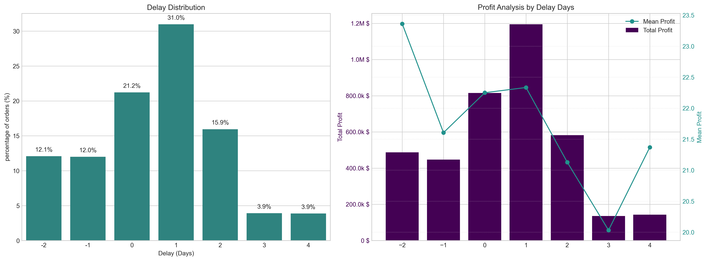
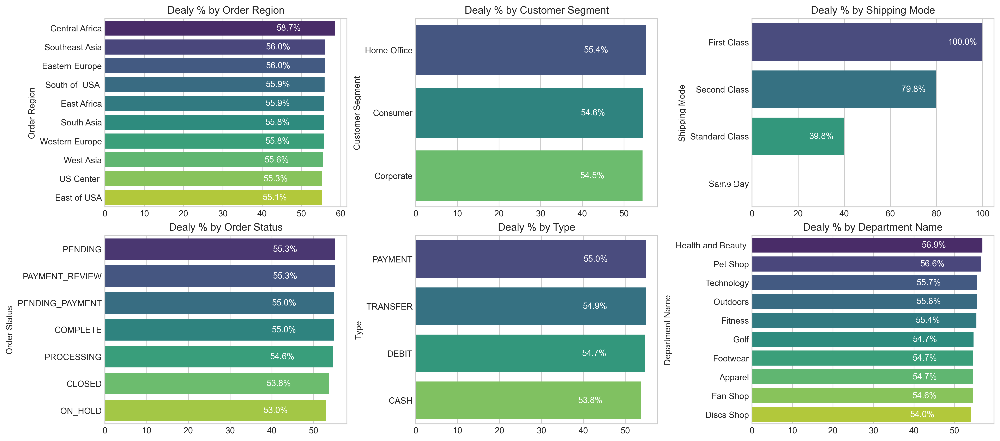
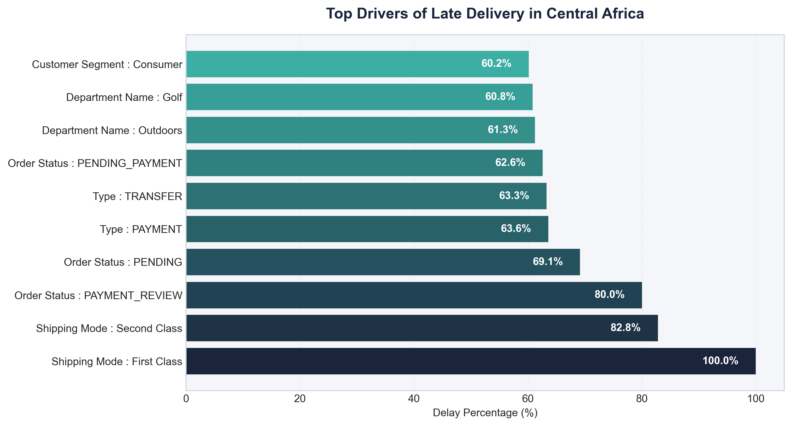
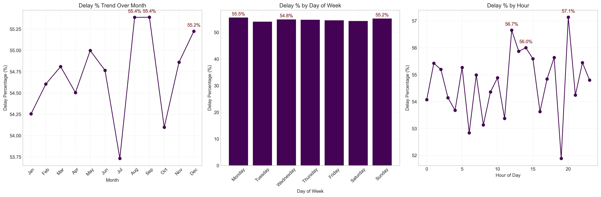
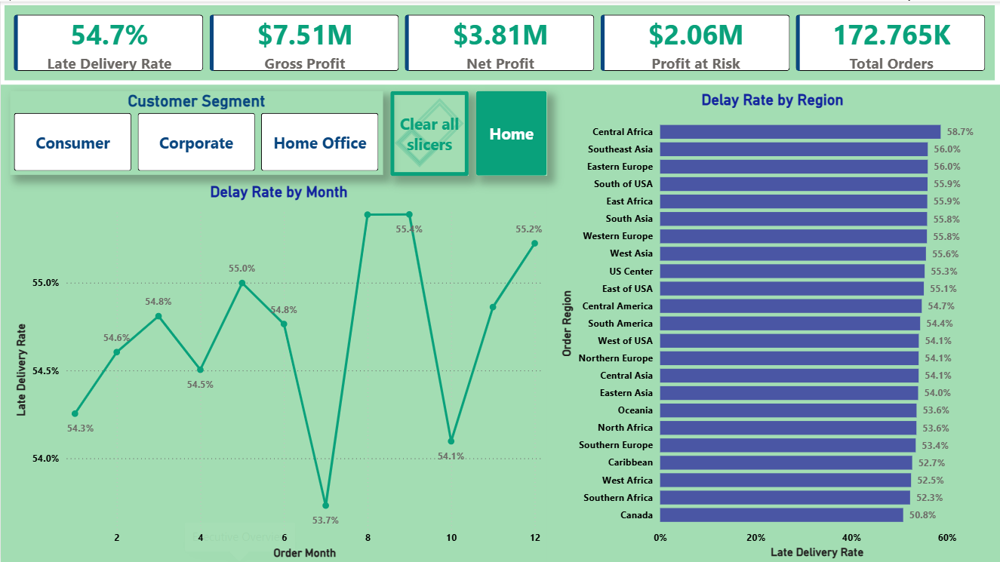
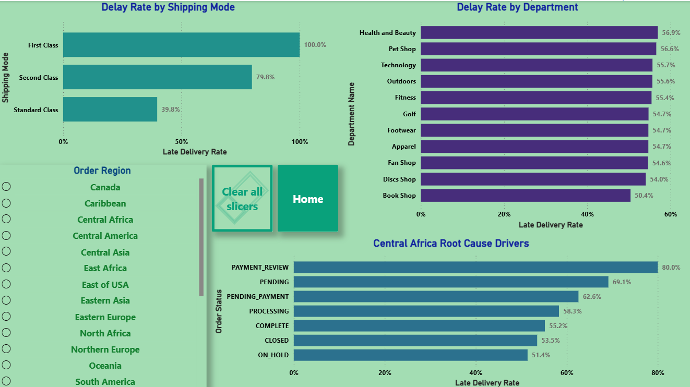
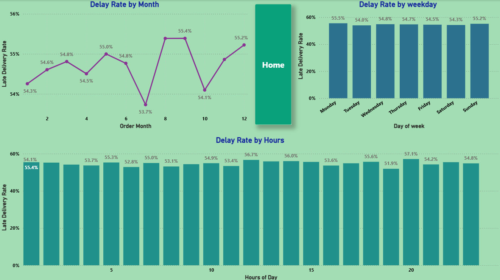

# 🚚 Supply Chain Delay Analysis

*Identifying why more than half of a global e-commerce company's orders arrive late, what it costs, and where to fix it, using Python and Power BI.*

---

## 📌 Table of Contents

- [Overview](#overview)
- [Business Problem](#business-problem)
- [Dataset](#dataset)
- [Tools & Technologies](#tools--technologies)
- [Project Structure](#project-structure)
- [Data Cleaning & Preparation](#data-cleaning--preparation)
- [Analysis & Key Findings](#analysis--key-findings)
- [Dashboard](#dashboard)
- [How to Run This Project](#how-to-run-this-project)
- [Recommendations](#recommendations)
- [Author & Contact](#author--contact)

---

## Overview

This project analyzes the delivery operations of a global e-commerce company to quantify the impact of late deliveries and uncover what drives them. Python (pandas, matplotlib, seaborn) was used for cleaning, exploratory analysis, and root-cause analysis. Power BI was used to build an interactive dashboard, and a written report translates the findings into prioritized recommendations.

**Headline results**

| Metric | Value |
|---|---|
| Orders analyzed | 172,765 (Jan 2015 – Jan 2018) |
| Late delivery rate | **54.71%** |
| Profit at risk from delayed orders | **$2.1M** |
| First Class shipping delay rate | **100%** |

---

## Business Problem

The company fulfills orders end to end across multiple regions, but actual shipping times often miss the scheduled delivery window. This erodes customer trust and makes order profitability unpredictable. This project aims to:

- Establish a baseline for delivery performance (late delivery rate, profit at risk)
- Quantify how delays relate to order profitability
- Identify the operational bottlenecks driving delays (shipping mode, region, department, order status)
- Detect seasonal and time-of-day patterns in delays
- Deliver actionable, prioritized recommendations for operations stakeholders

---

## Dataset

- **Source:** [DataCo Smart Supply Chain for Big Data Analysis (Kaggle)](https://www.kaggle.com/datasets/shashwatwork/dataco-smart-supply-chain-for-big-data-analysis)
- `data/DataCoSupplyChainDataset.csv`: raw order-level data (~180K rows, 50+ columns)
- `data/DescriptionDataCoSupplyChain.csv`: data dictionary
- `data/supply_chain_dashboard_data.csv`: cleaned extract with derived columns, used in Power BI

> The raw dataset is large. If it is not in the repo, download it from the Kaggle link above and place it in the `data/` folder.

---

## Tools & Technologies

- **Python:** pandas, NumPy, matplotlib, seaborn
- **Power BI:** data modeling, DAX measures, conditional formatting, cross-filtering
- **Jupyter Notebook**
- **GitHub**

---

## Project Structure

```
supply-chain-delay-analysis/
│
├── README.md
├── supply-chain-report.docx          # Written analytical report
│
├── notebook/
│   └── supply-chain-eda.ipynb        # Cleaning, KPIs, bottleneck & root-cause analysis
│
├── data/
│   ├── DataCoSupplyChainDataset.csv
│   ├── DescriptionDataCoSupplyChain.csv
│   └── supply_chain_dashboard_data.csv
│
├── dashboard/
│   └── supply-chain-delay-analysis.pbix
│
└── images/                           # Dashboard screenshots and analysis charts
```

---

## Data Cleaning & Preparation

- Dropped columns with no analytical value or personal information (customer names, email, password, street, product image/description)
- Converted order and shipping dates to datetime
- Derived the fields used throughout the analysis:
  - `Order Processing Time` = shipping date − order date (days)
  - `Delay` = processing time − scheduled shipping days
  - `Is_Delayed` = 1 when `Delay` > 0
  - `Profitability Flag` = Profit / Loss / Break-even, based on `Order Profit Per Order`
  - `order_month`, `order_day`, `order_hour` for time-based analysis
- Exported a slim cleaned extract for Power BI

---

## Analysis & Key Findings

### 1. Business KPIs
- **54.71%** of orders (94,523 of 172,765) were delivered late.
- **$2.1M** in profit sits on delayed orders.
- Even the 90th-percentile delay is only 3 days, so the problem is systemic and process-driven, not a handful of extreme failures.

### 2. Profitability vs. delay
- 80.7% of orders are profitable, 18.7% are loss-making, and 0.6% break even.
- Average profit per order stays roughly flat regardless of delay length, so the financial damage comes from the **volume** of delayed orders, not from late orders being individually less profitable.
- 31% of all orders arrive exactly 1 day late, the single largest group.



### 3. Bottleneck detection
- **Shipping mode is the biggest lever:** First Class 100%, Second Class 79.8%, Standard Class 39.8%, Same Day 0% late.
- Regions (55–59%) and customer segments (54.5–55.4%) are tightly clustered, which points to a company-wide issue rather than a local one.



### 4. Root-cause analysis (Central Africa)
- Central Africa has the highest regional delay rate (58.7%).
- Orders in `PAYMENT_REVIEW` status are **80%** late there, versus 55.3% overall, pointing to a payment-processing bottleneck.
- Outdoors (61.3%) and Golf (60.8%) departments are the worst performers in the region.



### 5. Time-based patterns
- Delay rates stay within a narrow 53–57% band, with peaks in **August and September (55.4%)** and **December (55.2%)** and a low in July.
- Day of week barely matters (under 1 percentage point of spread).
- Hour of day shows the clearest peaks: **21:00 (57.1%)**, 11:00 (56.7%), 12:00 (56.0%).



---

## Dashboard

An interactive 3-page Power BI dashboard (`dashboard/supply-chain-delay-analysis.pbix`) with custom DAX measures, conditional formatting, and cross-filtering by customer segment and region.

**Page 1: Executive Overview** (KPIs, delay trend by month, delay by region)



**Page 2: Bottleneck & Root Cause** (shipping mode, department, order-status drivers)



**Page 3: Time-Based Patterns** (month, day of week, hour of day)



---

## How to Run This Project

1. Clone the repository:

```
git clone https://github.com/<your-username>/supply-chain-delay-analysis.git
cd supply-chain-delay-analysis
```

2. Install dependencies:

```
pip install pandas numpy matplotlib seaborn jupyter
```

3. Make sure `DataCoSupplyChainDataset.csv` is in the `data/` folder (see [Dataset](#dataset)).
4. Open and run `notebook/supply-chain-eda.ipynb`. If the notebook reads the CSV from the project root, update the path to `../data/DataCoSupplyChainDataset.csv`.
5. Open `dashboard/supply-chain-delay-analysis.pbix` in Power BI Desktop (free).

---

## Recommendations

The full reasoning is in `supply-chain-report.docx`. In priority order:

1. **Audit First & Second Class shipping (critical):** 100% and 79.8% delay rates contradict the premium promise. Run a carrier SLA audit and consider suspending or repricing First Class until resolved.
2. **Resolve payment-processing bottlenecks (high):** `PAYMENT_REVIEW` and `PENDING_PAYMENT` orders are delayed far more often. Add automated escalation for stalled reviews.
3. **Plan for seasonal surges (medium):** build capacity plans ahead of August, September, and December.
4. **Default eligible orders to Standard Class (medium):** at 39.8% delay it vastly outperforms the premium tiers.
5. **Investigate high-delay departments in Central Africa (medium):** audit stock availability, pick-and-pack times, and carrier assignment for Outdoors and Golf.
6. **Review loss-making orders (low):** 18.7% of orders lose money. Check whether discounted orders are disproportionately late.

---

## Author & Contact

**Anas Ali Khan**
Data Analyst
📧 Email: anasalikhan951@gmail.com.com
🔗 [LinkedIn](https://www.linkedin.com/in/anas-ali-khan-1090x/)
